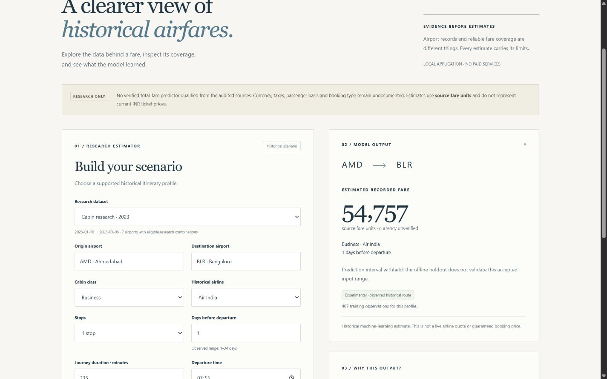
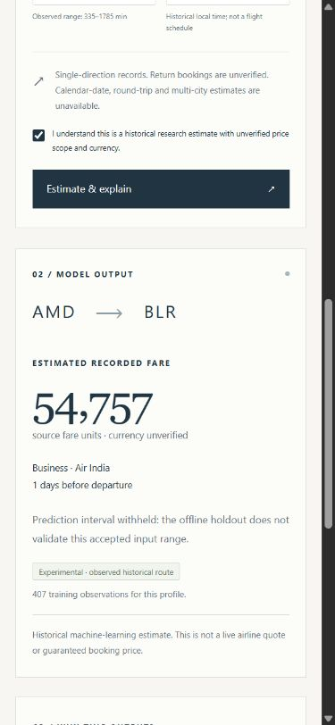

# Browser QA follow-up — 15 November 2026

**Passed for the exercised desktop and mobile viewport flows on both authorized origins.** The saved localhost permission block is resolved. The backend was launched using the unchanged `D:\SkyLens\run.ps1`; the existing frontend used `npm --prefix frontend run dev -- --port 5173 --strictPort`. Both remain running at [backend/application](http://127.0.0.1:8000) and [frontend](http://127.0.0.1:5173).

The authorized ChatGPT in-app browser was used throughout. No alternate browser, raw CDP, external browser automation, security change or permission bypass was used. Temporary viewport overrides were reset, QA-only tabs closed, and one normal application tab per origin retained.

## Executed checks

| Check | Observed result |
| --- | --- |
| Both origins | Application rendered on 8000 and 5173 and accepted supported native-model predictions. |
| Desktop | 1440×900 viewport override; document/client widths both 1425 CSS pixels. Estimator and output panels remain readable side by side. |
| Mobile | 390×844 and 360×800 overrides; document/client widths both 375 and 345 respectively. Form/results stack and navigation stays usable. No page-level horizontal overflow, including expanded explanations and methodology. |
| Acknowledgement | Submit initially disabled; checking the historical-research acknowledgement enables it. |
| Real output | Default AMD→BLR, Business/Air India: 54,757 displayed source fare units, 407 fitting observations, identical on both origins. The calculation shows 54,757.14. This is a historical prediction, **not a collected quote**. |
| Explanation | All 13 native SHAP contributions display: 13 data rows plus header. Baseline plus contributions equals the estimate; displayed additive error 5.1e-11. |
| Airport selection | Delhi search, ArrowDown/Enter selection, Mumbai destination selection and Escape restoration work. PNQ has no eligible estimator option; Enter produces no prediction, and blur/Escape restores the valid selection. |
| Dependent profiles | Route/cabin/airline changes update stops, numeric defaults and supported ranges and clear stale results. Economy/Indigo and narrow-mobile DEL→BOM scenarios also produced native outputs. |
| Numeric validation | Out-of-range lead is rejected by native form validation. Clearing lead/duration leaves an empty required field; fresh-page keyboard clearing/refilling produced no warnings/errors after the fix. |
| Time support | Keyboard-edited 23:59 was rejected with HTTP 422 and a support-range message. No fallback price appeared. A supported profile recovered normal prediction. |
| Journey scope | Single-direction research scope remains explicit. Calendar-date, verified one-way booking, return and multi-city estimates remain unavailable. |
| Unsupported cohort | Network 2020 displays the 50-observation warning, zero eligible airports and no prediction form/fallback. Switching back loads the cabin cohort. |
| Coverage | 661 directory records, 165 IATA codes, 88 fare endpoints, zero production-eligible airports. Next moves to page 2; search resets to page 1. PNQ gives one appropriately labeled row. No-match search gives zero records and disabled pagination. |
| Mobile tables | The 730-pixel directory table stays in its 339-pixel scroll container. Actual horizontal scrolling moved that container about 375 pixels while document width stayed 375. |
| Methodology | Both saved model results, source-unit errors and offline coverage render. The nominal interval label explicitly says not served. |
| API reference | After correction, frontend `/docs` renders Swagger and loads `/openapi.json`. Its actual browser GET `/health` returns 200 with both models loaded. |
| Loading | Actual initial loading and prediction-computation states were observed without injected responses or mock prices. |
| Outage/retry | Stopping the owned backend produced a clear unavailable message and Retry connection button. Browser health showed the expected proxy HTTP 500. Restarting the original `run.ps1` and clicking Retry restored predictions on both origins and health HTTP 200. |

## Defects reproduced and fixed

1. **Frontend API-reference navigation:** `/docs` returned the Vite SPA because it was absent from the proxy list. Added `/docs`, `/openapi.json` and `/fare-semantics` proxies. Swagger now renders and executes health successfully.
2. **Empty numeric fields:** keyboard deletion reproduced a React `NaN` value warning. Non-finite editing values now render as an empty string in both numeric controls. Required-field validation remains; no guessed zero is inserted. A fresh browser page passed clearing/refilling both inputs without warnings/errors.
3. **Text separators:** corrected the airport-selection separator and the methodology's question mark. The latter reads `90% nominal; not served`. No interval, metric or serving rule changed.

## Console and network

Final warning/error captures from the fresh frontend, production app and documentation tabs were empty. The earlier React warning is recorded as a fixed defect, not omitted.

Backend logs show **10 successful prediction and 10 successful explanation requests**, plus one deliberate prediction rejection (422). These are requests, including repeated scenarios, not independent fare observations. Inspected normal metadata/assets/documentation/health requests returned 200. The controlled outage generated six expected Vite `ECONNREFUSED 127.0.0.1:8000` failures: five startup requests and one browser health check. Browser health changed 200→500→200. No unexpected failure remained in final healthy checks.

A complete browser Network panel/HAR export is not exposed by this interface. Inspection used captured console messages, the real Swagger request/response panel and correlated backend/Vite logs. No full HAR review is claimed. See [browser evidence](browser_qa_followup_20261115.json) and [request summary](browser_qa_request_summary_20261115.json).

## Regression and limits

Python suite: **102 passed**, zero failures/errors/skips, one upstream Starlette/AnyIO deprecation warning, separate from browser console findings. TypeScript/Vite production build passed, and the updated bundle was loaded and exercised on port 8000. All **56 checkpointed data/model files** remain unchanged. No retraining, quote ingestion, lower support threshold, new airport or restored interval. The launch script is unchanged. Hosted Actions remains gated under the user's zero-spend decision.

This covers responsive Chromium viewport behavior, not physical iOS/Android devices, OS keyboards, Safari/Firefox or screen-reader testing. No remaining localhost browser permission denial was observed.

## Genuine screenshots

Direct browser captures after the fixes; JPEG content dimensions are 1425×891 and 375×812, distinct from the requested viewport overrides. No generated image, mockup or price substituted for a real result. Only the local research UI is shown, with its historical/source-unit disclosures.

Additional directory, methodology, controlled-outage and recovery captures remain locally in `.tools/browser-qa/`.
