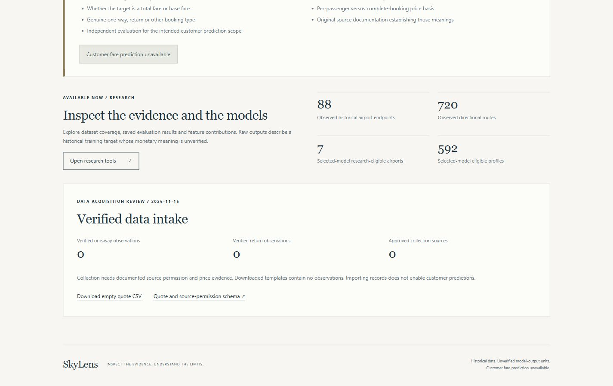
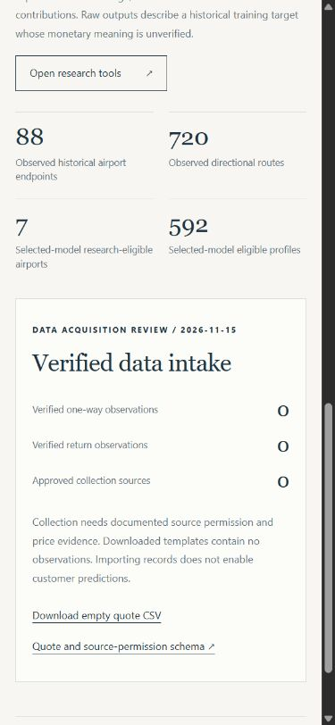

# Phase 5 implementation status

**The working research platform is preserved; verified customer prediction remains blocked by data.** New qualified one-way datasets: **0**. Genuine return datasets: **0**. No retraining, airport expansion, currency relabelling or restored intervals.

Implemented pinned audit acquisition/integrity checks, reproducible derivative/quality analysis, read-only acquisition status and empty CSV/schema downloads in the app. Manual intake now preserves optional license/reuse assertions and validates a supplied booking lead against actual dates without filling missing values. Existing permission/evidence/conflict gates and the Phase 4 product correction remain intact.

Actual coverage: 88 historical endpoints and 720 directional routes; 7 research-eligible airports, 42 research routes and 592 exact profiles. Customer/verified-journey coverage remains zero. Research supports historical single-direction records with Economy, Business and Premium Economy; First and genuine booking one-way/return/multi-city prediction remain unavailable.

Sources, actual rows, definitions, licenses and exclusions: [comparison](phase5_dataset_comparison.csv), [research](phase5_source_research.md), [price audit](phase5_price_definition_audit.md), [one-way](phase5_one_way_data_feasibility.md), [returns](phase5_round_trip_data_feasibility.md), [airport evidence](phase5_airport_expansion_opportunities.md), [decision](phase5_acquisition_decision.md), [model validation](phase5_model_validation.md). Raw candidate files and third-party snapshots remain ignored and are not published.

Verification: **155 complete Python tests passed**, **101 portable tests passed** in the separate minimal environment, **14 frontend tests passed**, and TypeScript/Vite production build passed. The existing Starlette/AnyIO deprecation is the sole Python warning. Hash checks preserve all **56 original data/model files** and five training/launch files. Existing split/leakage, native loading/prediction/SHAP and unsupported-request tests remain passing. A fresh pinned public archive download/extraction replay passed; no training was enabled.

Both origins passed live HTTP checks: acquisition assets/status, model/semantics/importance metadata, native research predictions and additive SHAP; unsupported airport/cabin/return/currency/acknowledgement inputs return 422, and customer/legacy endpoints return the intentional 503. See [HTTP evidence](phase5_http_verification.json) and [verification receipt](phase5_verification.json).

Actual in-app-browser QA passed desktop 1440×900 and mobile 390×844/360×800 flows. The empty CSV downloaded and contained one header line; the schema opened; native research analyses, thirteen SHAP rows, DEL/Economy selection, blank-input validation, PNQ exclusion/search, Methodology and the network no-profile state worked. Page widths remained 1425/1425, 375/375 and 345/345. Fresh desktop/mobile/schema console warning/error captures were empty. Normal inspected server requests were 200/304; deliberate 422/503 responses are expected. Full Network/HAR export is unavailable, so no exhaustive HAR claim. No browser security restriction was bypassed. Physical-device/other-browser certification is not claimed. [Browser receipt](phase5_browser_qa.json).

Npm audit reported zero vulnerabilities; compilation, documentation links, whitespace and staged/history repository guards passed with zero flagged secret/private/oversized payload findings. These are focused checks, not exhaustive security certification. Repository visibility remains public, and hosted CI stays gated under the existing zero-spend decision. Final commit/remote verification is reported on delivery; no skipped CI job is claimed as executed testing.

Remaining blocker: obtain an authentic source with documented all-in INR single-adult booking semantics, cabin/itinerary and observation times, usable collection/retention/ML rights, then enough independent observations to validate the intended serving scope. Draft source clarification is prepared but not sent. Budget remains ₹0.

Run the existing local workspace:

```powershell
Set-Location D:\SkyLens
.\run.ps1
```

Open [SkyLens](http://127.0.0.1:8000). Optional separate frontend: `npm --prefix frontend run dev -- --port 5173 --strictPort`. The script loads existing models and never retrains. Source-only clones still require the separately excluded original artifacts; no restricted data or model binary is committed.

Current direct browser captures:




