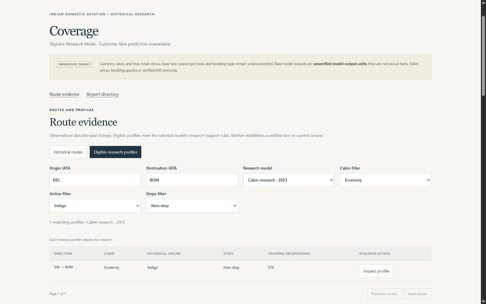

# Final browser QA — 16 November 2026

Passed in the authorized in-app Chromium browser on the built app (`127.0.0.1:8000`) and the dev proxy (`127.0.0.1:5173`). Live API receipts and backend/Vite logs were used to corroborate browser behavior; no full HAR export was available.

- Desktop 1440 × 900: DEL → BOM Economy historical filter showed 10,276 observations. The eligible Indigo non-stop profile showed 576 fitting observations, opened the exact form and required renewed acknowledgement. Native analysis and 13 additive SHAP rows rendered in unverified units. Both model metric rows and dataset details rendered.
- Mobile 390 × 844: Pune was searchable in the airport directory and unavailable in the eligible combobox. Keyboard selection of Delhi, blank-input validation and acknowledged analysis worked; 13 SHAP rows remained usable. At 360 × 800, the route table scrolled inside its 317 px container and the network model showed no eligible action.
- Document width matched viewport content at all three sizes (1425, 375 and 345 CSS pixels). Checked visible labels, keyboard selection, scoped table headings and focusable scroll regions. This is targeted QA, not full assistive-technology or physical-device certification.
- The CSV downloaded with a single header line; schema showed the source grant and evidence fields. The overview presented no raw model amount or currency symbol, and customer prediction stayed disabled.
- Stopping the owned backend produced five expected proxy connection errors; the UI withheld counts and offered retry. Launching again with `run.ps1` and retrying restored metadata, acquisition status and native analysis in the same dev tab. Healthy production, mobile, narrow and schema tabs had no captured console warnings/errors. No security settings were changed.

[Browser evidence](phase6_browser_qa.json) · [Mobile screenshot](../docs/screenshots/release-research-mobile.jpg)

