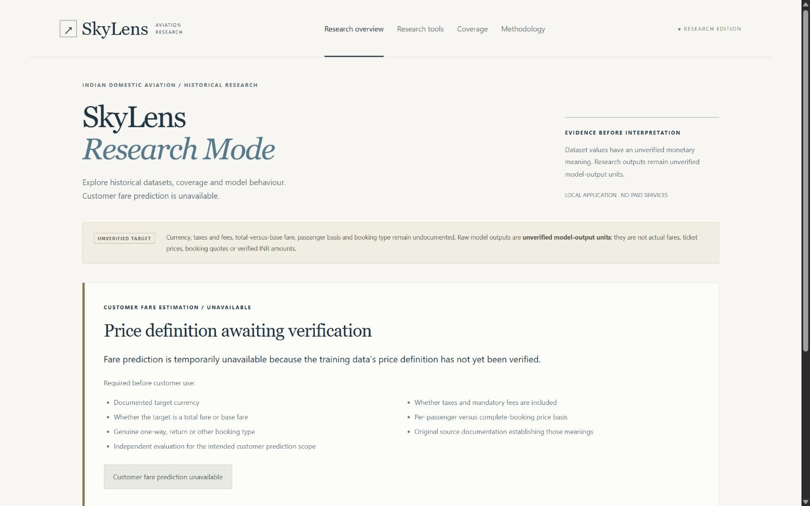
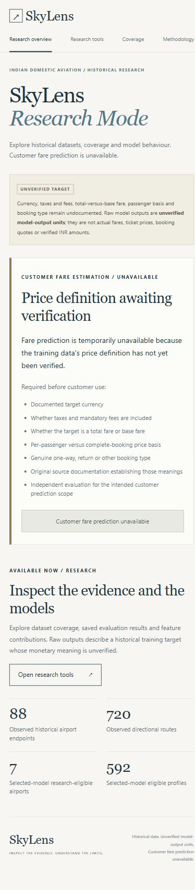
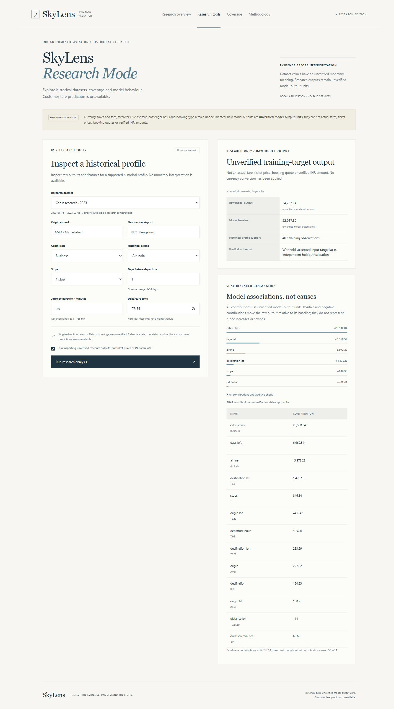

# Product correction — 15 November 2026

**Customer fare prediction is disabled. SkyLens opens in Research Mode without a model amount on the overview.** The earlier large “Estimated recorded fare” card implied a capability the evidence did not justify. Disclaimers did not resolve that presentation defect.

The customer status displays exactly:

> Fare prediction is temporarily unavailable because the training data's price definition has not yet been verified.

## Implemented behavior

The overview replaces the price card with research status, missing evidence, a disabled customer button and coverage facts. Currency, taxes/fees, total versus base fare, passenger basis, booking type, original source documentation and intended-scope independent validation are explicit prerequisites.

Research tools retain historical inputs, native outputs, SHAP, coverage and saved evaluations. Users must enter research tools and acknowledge the interpretation before analysis. Raw values appear in an ordinary small diagnostics table labelled **unverified model-output units**, without currency symbols, fake conversion or booking-price claims. SHAP uses the same units and explicitly does not represent rupee increases or savings.

`GET /capabilities` declares customer estimation unavailable. `POST /fare-estimate` and former generic `/predict` and `/explain` return **503 without invoking inference**. Explicit `/research/predict` and `/research/explain` retain acknowledgement, exact-profile and observed-range gates. Response schemas reject INR relabelling, customer promotion and restored intervals. Environment flags and metadata currency edits cannot enable customer use. Frontend validation additionally withholds unsafe or inconsistent responses. See [API migration](../docs/API_GUIDE.md) and the [frontend guide](../docs/FRONTEND_GUIDE.md).

## What the old number means

**54,757** was a rounded native output of the existing cabin model for the default Business/Air India AMD→BLR historical profile. The underlying output is approximately 54,757.14, predicting an undocumented numerical source field. It is not verified INR, a collected quote or a current booking price. The same unchanged model still produces it inside acknowledged research diagnostics; no guessed correction was applied.

The [source re-audit](price_target_reaudit_20261115.md) details publisher cards, headers, transformation code and unresolved definitions. Descriptions fetched again from Kaggle still do not establish currency or fare scope. Linked catalogues were not readable through the web tool. Future customer use needs authoritative record-linked semantics **and** independent evaluation for the intended serving scope.

## Scientific preservation

The baseline passed **102 tests**. A checkpoint and [hash manifest](../data/metadata/product_correction/preservation_baseline.json) recorded **56 original data/model files**. All retain identical SHA-256 hashes and sizes, including raw/processed/interim data, native binaries, support, importance and scientific metadata. No preparation/training code changed, retraining occurred, data was added, support threshold lowered or airport added. No paid service was used.

| Native model | SHA-256 | Unchanged final-test MAE / RMSE / R² |
| --- | --- | --- |
| cabin_2023 | `feaeadb9f82931f8aa048bf686ac0db7c9b178d3aa46fd219237a4e4df6b737f` | 2339.756824 / 4376.351779 / 0.947033389 |
| network_2020 | `9c98ad32b7f445cf5900cd9362554d2a2422de44893568537e27aa320480a8ff` | 2764.663128 / 4664.675451 / 0.426647012 |

MAE/RMSE remain unverified model-output units, not rupees. Minimum support stays 50 fitting observations per exact profile; 592 cabin profiles, seven eligible airports and zero eligible network profiles remain. Intervals stay withheld because the final holdout does not validate accepted numeric ranges. Original reports and screenshots are preserved; the older browser report is marked superseded for product semantics.

## Verification

- **129 Python tests passed**: all 102 original tests retained (research consumers migrated) and 27 added product/preservation checks. Native output, thirteen SHAP contributions, additive consistency and metadata-label non-promotion were checked with real artifacts. One existing upstream Starlette/AnyIO deprecation warning remains.
- **12 rendered-interface tests passed**: default disabled/no amount, no currency symbol, ordinary raw diagnostics, no conversion, unsafe INR/verification flags withheld, no served interval, unverified SHAP and honest loading/empty states. Existing React/Vite/Node dependencies only; software fixtures never enter training.
- TypeScript/Vite **production build passed**. All **77 portable tests passed** in the separate minimal-dependency environment. Portable CI includes product tests while both zero-spend job gates remain in place.
- Repository staged/history guards found no flagged secret, private payload or oversized blob. Full npm audit reported zero vulnerabilities; documentation links and whitespace checks passed. These focused checks do not claim exhaustive security certification.
- Actual browser checks on both allowed origins passed: 1440×900, 390×844 and 360×800 overrides yielded client/scroll widths 1425/1425, 375/375 and 345/345. No page overflow, including the expanded thirteen-row SHAP table. Default overview has no model amount and a disabled customer button.
- Exercised acknowledgement, same native research output on both origins, blank/range validation, PNQ exclusion, network no-profile state, coverage search and Methodology. Swagger executed a real customer request: **503**, exact required message and missing evidence.
- Application desktop/mobile console captures were empty. Reloading a Swagger deep link produced one upstream Swagger UI 5 deprecation about underscore whitespace escaping; documented in [browser evidence](product_correction_browser_qa.json). It does not affect the application or unavailable response.
- Normal inspected assets, metadata, OpenAPI and research requests returned 200 in server logs. Customer 503 is intentional. No complete Network/HAR export is exposed, so exhaustive HAR inspection is not claimed. No permission denial or bypass occurred. Temporary viewport tabs were closed; normal tabs and both local services remain available.

This is Chromium viewport QA, not physical-device, other-browser or screen-reader certification. `run.ps1` is unchanged. Repository visibility remains public by the user's prior decision. Hosted CI remains gated; skipped jobs are not passing remote execution.

## Current genuine screenshots

Direct captures of the corrected application, without mockups or substituted values.

